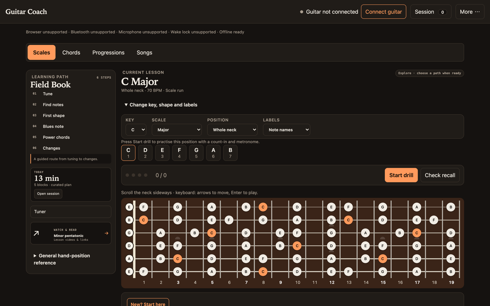

<h1 align="center">Guitar Coach</h1>

<p align="center">
  <strong>A browser-based practice coach for the Poputar T2 LED guitar —<br>it lights the neck, then fades the lights until you can play without them.</strong>
</p>

<p align="center">
  <a href="https://anibalribeiro.github.io/guitar-coach/">Live app</a> ·
  <a href="#run">Run locally</a> ·
  <a href="PROTOCOL.md">BLE protocol</a> ·
  <a href="docs/HARDWARE-CHECKLIST.md">Hardware checklist</a>
</p>

<p align="center">
  
  
  
  
  
</p>

<p align="center">
  
</p>

---

The Poputar T2 has an LED under every fret. Its official app uses
those lights as a permanent crutch. **Guitar Coach uses them as scaffolding:** it shows you where to
play, checks that you can play it, and then takes the hints away until you can recall the notes
and changes on your own.

## Features

- **Scales, chords, progressions and songs** on screen and on the guitar's LED neck, by key,
  position and label mode (note names, intervals, degrees, finger numbers).
- **Fading drills** — timed scale and change drills that step from the full pattern down to no
  lights, followed by a mandatory no-light recall pass.
- **Microphone scoring (optional)** — an in-browser pitch detector scores notes and timing; every
  drill also works without a mic using quizzes or self-report.
- **Generated backing tracks and metronome** — synthesized in Web Audio; no samples, no streaming.
- **Spaced review and mastery** — per-skill mastery, a daily session plan, review scheduling and
  a streak, all stored locally with JSON export/import.
- **Learning path** — a guided route from tuning (built-in tuner) to note finding, shapes,
  power chords and changes, with short generated demo clips.
- **Offline and private** — a static site with a service worker; no backend, no account, no
  tracking.
- **Reverse-engineered BLE protocol** — documented in [`PROTOCOL.md`](PROTOCOL.md), with a
  standalone Python probe that refuses to touch the firmware-update (OTA) characteristic.

> **Browser support:** Web Bluetooth needs Chrome or Edge on desktop, or Chrome on Android.
> iOS/Safari and Firefox can browse the app, but cannot connect to the guitar.

## Quick start

```sh
git clone https://github.com/anibalribeiro/guitar-coach.git
cd guitar-coach/app && python3 -m http.server 8765
```

Open <http://localhost:8765> in Chrome or Edge, close the official Poputar app (the guitar
accepts only one Bluetooth connection), and press **Connect guitar**. You don't need the guitar
to try the app: without it, every drill runs on screen only.

The light Daylight interface has four tabs (**Today**, **Practice**, **Progress**, **Library**:
a floating bar on phones, pill tabs on desktop), a connection pill that shows the guitar and its
battery, and a **More** sheet with the Tuner, Microphone, Backup and Settings.
Library opens on **Songs** (chord line, first lyric line and a lamp per section), with Scales,
Chords and Progressions tabs and one search field; choosing an item opens it in Practice.

## How it is built

No framework, no bundler and no dependencies: plain HTML, CSS and twenty native ES modules,
arranged in a one-way tier rule (pure domain → engines/adapters → UI → composition root) that the
test suite enforces.

| Path | What it is |
|------|------------|
| `app/index.html` | The only HTML entry: markup plus inline CSS, loading `./src/main.js`. |
| `app/src/*.js` | Twenty ES modules, from `content` and `theory` through `panels` and the `main` composition root. |
| `app/sw.js` | Same-origin offline cache for the shell, modules and lesson clips. |
| `app/assets/videos/` | Generated lesson clips and posters, plus one Pexels reference clip and photo ([credits](docs/MEDIA-CREDITS.md)). |
| `tests/` | `node:test` suites for every pure module, plus static architecture and safety audits. |
| `tools/ble_probe.py` | A standalone BLE probe (scan/dump/listen/write) that refuses OTA writes. |
| `tools/make_lesson_videos.py` | Regenerates the lesson clips from drawing primitives. |
| `PROTOCOL.md` | Reverse-engineered BLE frame and GATT contract. |
| `docs/` | Hardware acceptance checklists, media credits, design mockups and reviews. |

## Learn

The coach rail's **New? Start here** opens the note-finding path with tuning first. The **Tuner**
uses the microphone and shows the nearest note plus cents flat/sharp. Every lesson carries a shape
diagram, four steps, an audible **Hear it**, a short demo clip, a real reference photo and clip,
and external watch/read links. YouTube cards have an on-demand **Play here** button that loads the official no-cookie embed; that one player needs a network. The self-hosted clips and real media remain offline. The real reference and background reading are collapsed by default. **Finger numbers** is a board label mode, and the
Blues scale and power chords have their own lesson variants. The daily Session panel remains the
spine: warm-up, focus, new material, play-along and recall, each with its reason.

## Independent recall

**Start drill** teaches a skill through the hint fade. **Check recall** runs one attempt directly
at No lights, with no target melody; the click remains. Try it before warming up on that skill.
The Session plan's Recall block and due-focus block use this independent path.

A clean independent attempt on a later day earns **Retained later**. A clean attempt today is
**Recalled today**. Repeating guided practice or repeating on the same day does not extend the
review interval. A skill becomes lapsed only after it is more than 14 days overdue.

Results distinguish quiz, microphone and self-reported evidence. Wrong/revealed quiz answers
cannot be marked clean. If the microphone misses a clean performance, use the explicit correction
button; the original measurement and correction stay in the local backup. Scale scoring requires
the requested octave, counts attacks/legato pitch changes once, and preserves early/late timing.
The metronome uses short unpitched ticks to reduce pitch leakage; headphones remain useful.

## Progress and backup

Everything lives in this browser, under the single `t2coach.v1` record (schema 2: settings plus the
progress plane). A version 1 record migrates once and keeps a `t2coach.v1.migration-backup` copy.
**Progress** is one of the four tabs (Today, Practice, Progress, Library). It shows the streak,
practised and unguided minutes, due reviews, the last 20 sessions and per-skill mastery. Backup
lives in **More › Backup**: **Export JSON** downloads one file (`t2coach-backup-YYYY-MM-DD.json`);
**Import JSON** validates the whole document and asks for an explicit **Replace data**
confirmation before overwriting anything. The app remembers the tab you were on and reopens it.

## Run

A static server is mandatory for every mode: ES modules do not load from `file://`.

```
cd app && python3 -m http.server 8765
```

Open <http://localhost:8765> in **Chrome** or **Edge** (Web Bluetooth needs `localhost` or HTTPS).
Close the official Poputar app first: the guitar accepts one BLE connection at a time. Practice
works with the guitar disconnected — the drill is screen-only, never an error state.

A denied microphone is reset from the browser's site settings, not from the app, and every drill
runs unscored without it.

The service worker installs the page and modules as one release and caches local lesson media. After
that first load the app, including the video demos, keeps working with no network. External
watch-and-read links are the only things that need a connection.

On Android the page must be served over HTTPS; use the GitHub Pages deploy below.

## Test

```
node --test
node --test tests/transport.test.js
python3 tests/test_probe_refusal.py
```

Optional browser regressions use an existing Playwright installation and the running static server:

```
PLAYWRIGHT_MODULE=/path/to/playwright node tools/check_browser.cjs
```

The browser check covers keyboard/Stage-mode answer privacy, mobile layout, lesson focus, independent
recall, late microphone grants and offline reload. It saves screenshots in a temporary directory.

A manual layout gate checks that no tab (and no open More sheet) scrolls sideways at 360, 390, 768,
1024 and 1440px. It needs a local Chrome (or `CHROME=/path/to/chrome`) and is not run in CI:

```
node tools/overflow_probe.mjs
```

`node --test` discovers every suite from the repository root. The probe refusal test uses only
the Python standard library and does not require `bleak` or a guitar.

## Deploy

`.github/workflows/pages.yml` uploads only `app/` with `actions/upload-pages-artifact`
(`path: app`) and deploys with `actions/deploy-pages`; there is no build command and no secret.
The live deployment is <https://anibalribeiro.github.io/guitar-coach/>. For a fork, set
**Settings → Pages → Build and deployment → Source** to **GitHub Actions**.

- Project sites live under `https://<owner>.github.io/<repository>/`, so every URL and import
  stays relative; root-absolute paths would 404.
- Android Chrome requires the HTTPS Pages URL; a plain-HTTP LAN address will not expose
  Web Bluetooth.
- Close all tabs for this app and reopen after a deploy so the complete waiting release can activate.
- Bump the release in `app/sw.js` whenever the shell or a module changes. Installed shell files are immutable; individual network files never replace them. Recovery clears only this app scope and preserves progress.
- The deployment workflow runs the Node and Python safety tests before uploading `app/`.
- `localStorage` is origin-scoped: settings saved on `http://localhost:8765` do not follow to
  the deployed host (or to `127.0.0.1`); the new origin starts from the defaults.

## Safety

The T2 exposes a Telink OTA (firmware update) characteristic. Neither the app nor the probe ever
writes to it: the app sends only the documented `F1` LED frame, and `tools/ble_probe.py`
hard-refuses the entire OTA service before any I/O. Tests enforce both.

## Disclaimer

This is an independent, unofficial project. It is not affiliated with or endorsed by Poputar.
"Poputar" and "T2" are used only to identify the compatible hardware. The protocol was documented
for interoperability; no proprietary code or assets from the official app are included.

## License

[MIT](LICENSE) © Aníbal Ribeiro
